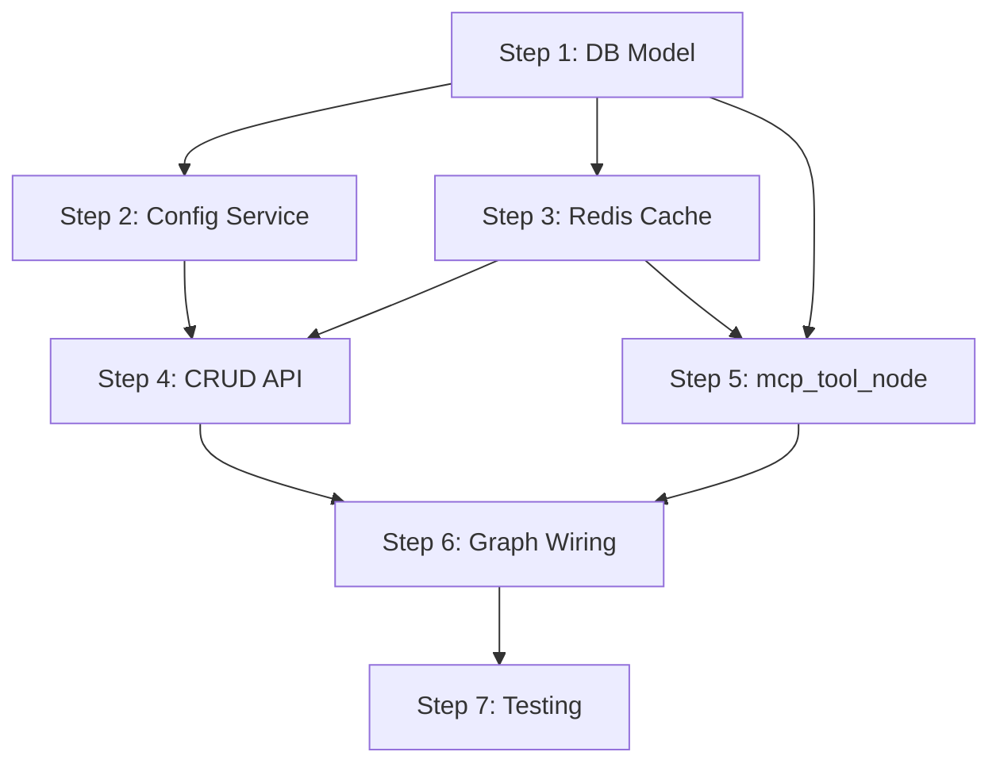

# User MCP Config System — Implementation Plan (v3)

> **Goal**: Users register remote MCP servers via JSON config. Agent discovers, binds, and executes their tools in isolation — zero impact on the existing 9-provider system.

---

## Decisions

| Decision | Choice | Why |
|---|---|---|
| SDK | `langchain-mcp-adapters` / `MultiServerMCPClient` | Already in use, returns LangChain-native tools |
| Table | One `config_json` column per user | Single source of truth — Redis caches schemas |
| Transport | Remote HTTP/SSE only | Security — no process spawning |
| Tool naming | `servername__toolname` prefix | Prevents collisions across servers |
| Bind-time strategy | Reconstruct `StructuredTool` from cached schemas | Zero MCP connections at bind time |
| Execution | Prebuilt `ToolNode` with live `MultiServerMCPClient` tools | Handles matching, parallel exec, errors |
| Dispatcher | `Send()` with **filtered** state per node | Each node only sees its own tool calls |

---

## Step 1 — Database Model + Migration

**Modify:** `db/models.py`, auto-generate Alembic migration

```python
class UserMCPConfig(Base):
    __tablename__ = "user_mcp_configs"

    id: Mapped[str] = mapped_column(String, primary_key=True, default=lambda: str(uuid.uuid4()))
    user_id: Mapped[uuid.UUID] = mapped_column(
        ForeignKey("user.id", ondelete="CASCADE"), nullable=False, unique=True, index=True
    )
    config_json: Mapped[dict] = mapped_column(JSON, nullable=False, default=dict)
    created_at: Mapped[datetime] = mapped_column(DateTime(timezone=True), server_default=func.now())
    updated_at: Mapped[datetime] = mapped_column(DateTime(timezone=True), server_default=func.now(), onupdate=func.now())

    user: Mapped["User"] = relationship(back_populates="mcp_config")
```

Add reverse on `User`: `mcp_config: Mapped[Optional["UserMCPConfig"]] = relationship(back_populates="user", uselist=False, cascade="all, delete-orphan")`

Then: `alembic revision --autogenerate` + `alembic upgrade head`

**Depends on:** Nothing

---

## Step 2 — Config Validation + Schema Discovery Service

**Create:** `services/mcp_config_service.py`

### 2a. `validate_config(config_json: dict) -> dict`
- Reject `stdio`: error if entry has `command`, `args`, or `transport: "stdio"`
- **SSRF**: block `127.x`, `10.x`, `172.16-31.x`, `192.168.x`, `169.254.x`, `localhost`, `0.0.0.0`
- Enforce HTTPS in production
- Max 10 servers, max 64KB config size
- Return sanitized config or raise `ValueError`

### 2b. `discover_tools(config_json: dict) -> list[dict]`
- Build `MultiServerMCPClient` config with `tool_name_prefix=True` → tools become `servername__toolname`
- Connect with 10s timeout, call `get_tools()`
- Extract and return serializable schema list:
  ```python
  [{"name": "exa__search", "description": "...", "inputSchema": {...}}, ...]
  ```
- This format is what gets cached in Redis and used by `build_schema_tools()` at bind time
- If a server is unreachable, raise with the server name

### 2c. `build_schema_tools(tool_schemas: list[dict]) -> list[StructuredTool]`
- Takes the cached schema list from Redis
- Builds schema-only `StructuredTool` objects using `_build_schema_only_tool()` (reuse existing logic from [remote_mcp_client_config.py:179-220](file:///home/dell/Desktop/Orphic-Do-Beyond-Ordinary/protocols/mcp/remote_mcp_client_config.py#L179-L220))
- These are for `bind_tools()` ONLY — not executable
- **Zero network calls** — pure local object construction from cached JSON

> [!IMPORTANT]
> `build_schema_tools()` exists because of a critical performance constraint: we cannot connect to MCP servers on every agent turn just for `bind_tools()`. Schemas are cached at save time, reconstructed locally at bind time. MCP connections only happen during actual tool execution in `mcp_tool_node`.

**Depends on:** Step 1

---

## Step 3 — Redis Cache Layer

**Modify:** `services/cache.py`

Add these functions:

```python
# ── MCP Config Cache ──────────────────────────────────────────

# Key: mcp_config_version:{user_id} — MD5 hash, no TTL (explicit invalidation)
async def get_mcp_config_version(user_id: str) -> str | None
async def set_mcp_config_version(user_id: str, version_hash: str) -> None
async def invalidate_mcp_config(user_id: str) -> None  # deletes ALL mcp keys for user

# Key: mcp_config:{user_id} — the raw config_json, TTL 3600s
async def get_cached_mcp_config(user_id: str) -> dict | None
async def set_cached_mcp_config(user_id: str, config: dict, ttl: int = 3600) -> None

# Key: mcp_tool_schemas:{user_id} — discovered tool schemas list, TTL 3600s
async def get_cached_mcp_tool_schemas(user_id: str) -> list[dict] | None
async def set_cached_mcp_tool_schemas(user_id: str, schemas: list[dict], ttl: int = 3600) -> None
```

**Cache flow summary:**

| When | What happens | MCP connection? |
|---|---|---|
| `PUT /mcp-config` | validate → discover → cache config + schemas + version in Redis | Yes (once) |
| `agent_node` bind time | Redis GET schemas → `build_schema_tools()` → `bind_tools()` | **No** |
| `agent_node` cache miss | DB GET config → re-discover → cache → bind | Yes (rare) |
| `mcp_tool_node` exec time | Redis GET config → `MultiServerMCPClient` → prebuilt `ToolNode` | Yes (only when tool called) |

**Depends on:** Nothing

---

## Step 4 — CRUD API Router

**Create:** `api/mcp_config_router.py`  
**Modify:** `app.py` — add 1 line to register router

### `GET /mcp-config`
- Returns user's config + last discovered tool names + `updated_at`

### `PUT /mcp-config`
- Validate config → discover tools → upsert DB row → set Redis (config + schemas + version hash)
- Response: `{status: "saved", servers: [...], tools_discovered: N}`

### `DELETE /mcp-config`
- Delete DB row → `invalidate_mcp_config(user_id)` (clears all Redis keys)
- Response: `{status: "deleted"}`

### `POST /mcp-config/test`
- Accepts single server `{name, url, headers}` — validates + test-connects — does NOT save
- Response: `{reachable: true, tools: [{name, description}]}`

> [!NOTE]
> No `/refresh` endpoint. Users re-PUT the same config to re-discover tools. One less endpoint to maintain, same functionality.

**Depends on:** Steps 1, 2, 3

---

## Step 5 — mcp_tool_node with Prebuilt ToolNode

**Create:** `protocols/mcp/user_mcp_tool_node.py`

```python
async def mcp_tool_node(state: AgentState, config: RunnableConfig) -> dict:
    user_id = state["user_id"]
    
    # 1. Load config (Redis → DB fallback)
    user_config = await get_cached_mcp_config(user_id)
    if not user_config:
        user_config = await load_from_db(user_id)
        if not user_config:
            return {"messages": [error ToolMessages for each call]}
    
    # 2. Build MultiServerMCPClient config with tool_name_prefix
    mcp_cfg = {
        name: {"transport": "http", **server}
        for name, server in user_config.items()
    }
    
    # 3. Connect, get executable tools, run via prebuilt ToolNode
    async with MultiServerMCPClient(mcp_cfg) as client:
        tools = client.get_tools()      # live, executable, prefixed
        node = ToolNode(tools)
        return await node.ainvoke(state) # matches by prefixed name, parallel exec
```

**Key point:** This node only receives MCP tool calls in its state (filtered by the `Send()` router in Step 6). The prebuilt `ToolNode` matches `tool_calls[].name` against the prefixed tool names from `get_tools()` and executes them.

**Depends on:** Steps 1, 3

---

## Step 6 — Graph Wiring

**Modify:** `orchestrators/graph.py` — three surgical changes

### 6a. Register new node (in `initialize_graph`)

```python
from protocols.mcp.user_mcp_tool_node import mcp_tool_node
builder.add_node("mcp_tool_node", mcp_tool_node)
builder.add_edge("mcp_tool_node", "agent_node")
```

### 6b. Send() router with filtered state

```python
from langgraph.types import Send

def _route_after_agent(state: AgentState):
    last = state["messages"][-1]
    if not isinstance(last, AIMessage) or not getattr(last, "tool_calls", None):
        return END
    
    fixed_calls = []
    mcp_calls = []
    for tc in last.tool_calls:
        if tc["name"] in tool_provider_map or tc["name"] in _executable_tools:
            fixed_calls.append(tc)
        else:
            mcp_calls.append(tc)
    
    sends = []
    if fixed_calls:
        # Reconstruct AIMessage with ONLY fixed tool calls
        filtered_msg = AIMessage(content=last.content, tool_calls=fixed_calls, id=last.id)
        filtered_state = {**state, "messages": state["messages"][:-1] + [filtered_msg]}
        sends.append(Send("tool_node", filtered_state))
    if mcp_calls:
        # Reconstruct AIMessage with ONLY MCP tool calls
        filtered_msg = AIMessage(content=last.content, tool_calls=mcp_calls, id=last.id)
        filtered_state = {**state, "messages": state["messages"][:-1] + [filtered_msg]}
        sends.append(Send("mcp_tool_node", filtered_state))
    
    return sends
```

Each node only sees its own tool calls. Both return `ToolMessage` lists with correct `tool_call_id`s. The `add_messages` reducer merges them back. The filtered states are **inputs** to the nodes, not modifications to the graph state — the original AIMessage with all tool calls remains in the checkpointed state.

### 6c. Dynamic tool binding in agent_node (zero network)

Between system prompt build (~line 200) and LLM call (~line 208):

```python
# Load user MCP tool schemas for binding (cache-only, no MCP connection)
user_mcp_tools = []
try:
    from services.cache import get_mcp_config_version, get_cached_mcp_tool_schemas
    from services.mcp_config_service import build_schema_tools
    
    version = await get_mcp_config_version(user_id)
    if version:
        schemas = await get_cached_mcp_tool_schemas(user_id)
        if schemas:
            user_mcp_tools = build_schema_tools(schemas)  # local reconstruction, zero network
        else:
            # Cache miss — reload from DB, re-discover, re-cache
            # (happens once after Redis restart or TTL expiry)
            ...
except Exception as e:
    logger.warning(f"User MCP tool loading failed for {user_id}: {e}")

if user_mcp_tools:
    all_tools = schema_tools + list(_executable_tools.values()) + user_mcp_tools
    active_llm = SUPPORTED_MODELS.get(requested_model, SUPPORTED_MODELS["gpt-5-nano"]).bind_tools(all_tools)
else:
    active_llm = _bounded_models.get(requested_model, _bounded_models["gpt-5-nano"])
```

**Zero MCP connections.** Pure Redis GET + local StructuredTool construction. The only time MCP servers are contacted at bind time is a cache miss after Redis restart — and even that's automated.

**Depends on:** Steps 2, 3, 5

---

## Step 7 — Testing

**Create:** `tests/test_mcp_config.py`

| Test | Validates |
|---|---|
| `test_validate_blocks_stdio` | Rejects stdio configs |
| `test_validate_blocks_ssrf` | Rejects private IPs |
| `test_tool_name_prefixing` | `discover_tools` returns `servername__toolname` format |
| `test_build_schema_tools` | Cached schemas → StructuredTool objects correctly |
| `test_route_fixed_only` | Send only to `tool_node` |
| `test_route_mcp_only` | Send only to `mcp_tool_node` |
| `test_route_mixed_filtered` | Both Sends have filtered, non-overlapping tool calls |
| `test_tool_isolation` | User A's tools don't appear in User B's binding |
| `test_crud_lifecycle` | PUT → GET → DELETE |
| `test_e2e_execution` | Config → bind → LLM calls prefixed tool → ToolNode executes |

---

## File Summary

| File | Action |
|---|---|
| `db/models.py` | Modify — add `UserMCPConfig` |
| `alembic/versions/xxxx_...py` | Create — migration |
| `services/mcp_config_service.py` | **Create** — validate, discover, build_schema_tools |
| `services/cache.py` | Modify — add 6 MCP cache functions |
| `api/mcp_config_router.py` | **Create** — 4 endpoints |
| `app.py` | Modify — register router (1 line) |
| `protocols/mcp/user_mcp_tool_node.py` | **Create** — prebuilt ToolNode wrapper |
| `orchestrators/graph.py` | Modify — new node, Send() router, dynamic bind |

**3 new files. 4 modified. 0 changes to existing tool_node, providers, or oauth.**

## Execution Order


